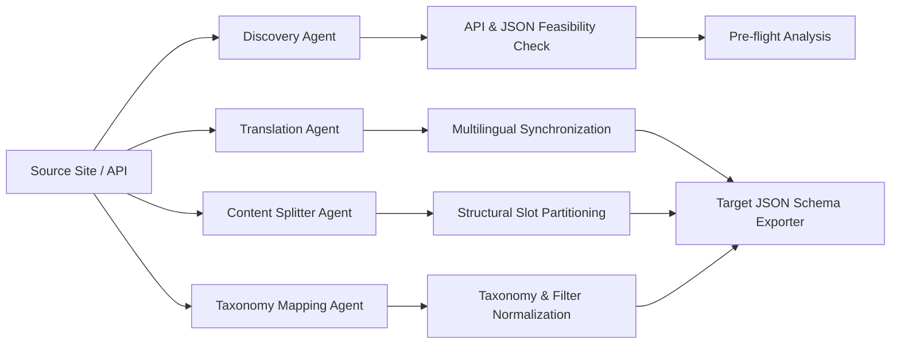

# Universal Content Migration Platform - Worker Agents Architecture

This document describes the architecture, roles, and execution mechanics of the autonomous background worker agents powering the content migration and JSON export pipeline.

---

## 1. Architectural Overview & Objectives

The platform transforms unstructured or semi-structured web content from varied source platforms into normalized, schema-compliant JSON payloads for modern target headless CMS systems.

### Core Migration Challenges Handled by the Platform:
1. **Unstructured Stream to Semantic Layout Slots**: Monolithic content streams (containing mixed text, media, embeds, and block elements) are segmented into clean, discrete layout fields:
   - Lead introductory summary (`item-intro-text`)
   - Primary narrative block (`text-1`)
   - Featured visual media asset & caption (`media-2`, `media-2-text`)
   - Secondary narrative block (`text-2`)
   - Social & interactive embeds (`instagram`, video, or rich widgets)
   - Secondary visual media asset & caption (`media-3`, `media-3-text`)
   - Supplemental body blocks (`text-3`)
2. **Taxonomy & Filter Categorization**: Freeform source tags, categories, and labels are mapped into structured taxonomy trees and target filter IDs.
3. **Multilingual Content Synchronization**: Translations across different locales are synchronized into unified item schemas.

---

## 2. Worker Execution Model

> [!NOTE]
> The platform uses **autonomous deterministic worker agents** implemented in Python.

### Why Deterministic Agents?
1. **Zero Hallucination & Exact Fidelity**: Large batches of publications containing precise links, source citations, and media URLs are transferred without modification or omission.
2. **Predictable Performance**: Zero token costs, no rate limiting, and sub-second processing per article.
3. **Strict Schema Compliance**: Output JSON structures strictly adhere to target CMS import specifications.

---

## 3. Coordinated Worker Agents

The migration pipeline coordinates four specialized worker agents (`agents.py`):

### 1. Discovery Agent (`sources/detector.py`)
- **Role**: Probes target URLs to identify active REST endpoints, feed availability, and export readiness.
- **Capabilities**:
  - Detects endpoint discovery headers and HTML tags.
  - Verifies route availability and total item counts.
  - Feeds capability metrics into the pre-flight analysis interface.

### 2. Content Splitter Agent (`splitter.py`)
- **Role**: Parses raw source HTML, normalizes markup, and partitions content into target layout slots.
- **Rules Executed**:
  - Isolates introductory summaries from body text.
  - Strips redundant titles duplicating the headline.
  - Normalizes header typography to target design system guidelines.
  - Resolves media assets to full-resolution originals by removing thumbnail dimension suffixes.
  - Isolates external embeds into designated media slots.

### 3. Translation Agent (`multi_lang.py`)
- **Role**: Identifies, correlates, and aggregates multilingual versions of each item.
- **Rules Executed**:
  - Discovers matching language counterparts across publication timelines and media asset signatures.
  - Generates synchronized multi-language dictionary structures.
  - Populates the pre-flight **Analyze** matrix to verify translation coverage before running exports.

### 4. Taxonomy Agent (`tag_mapper.py`)
- **Role**: Reconciles legacy source tags and categories with the target taxonomy tree.
- **Rules Executed**:
  - Combines baseline mapping rules with persistent user-defined overrides.
  - Emits clean, accessible HTML tag lists for display slots.
  - Assigns target numeric filter IDs for catalog navigation.
