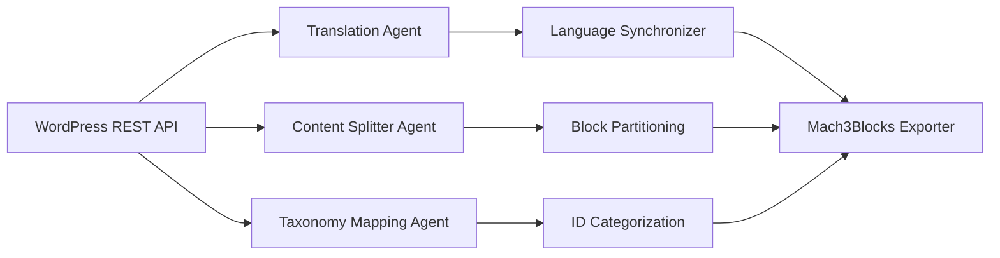

# Migration Studio - Autonomous Background Agents

This document outlines the architecture, roles, context, and operational mechanics of the agents within the Anthuriuminfo to Mach3Blocks Migration Studio.

---

## 1. Project Context & Objectives

The goal of this project is to migrate historical blog publications from WordPress (`https://anthuriuminfo.com/blog/`, 494 articles in Dutch, plus multilingual counterparts in English, German, and French) into a modern headless CMS platform (**Mach3Blocks**).

### Architectural Differences Between Old and New Sites:
1. **Unstructured to Structured**: On WordPress, all post text, captions, and images are bundled into a single HTML stream (`.main-content > .content-left`). On Mach3Blocks, posts must be partitioned into specific slots:
   - `item-intro-text` (Lead paragraph)
   - `text-1` (First body block)
   - `media-2` + `media-2-text` (Featured body image & caption)
   - `text-2` (Second body block)
   - `instagram` (Instagram post / reel link)
   - `media-3` + `media-3-text` (Secondary image & caption)
   - `text-3` (Remaining body content with all remaining visual assets)
2. **Taxonomy & Categorization**: The old site uses freeform WordPress tags (212 tags) and 9 categories. Mach3Blocks requires strict categorization into hierarchical integer ID buckets (`Verzorging: 57156`, `Inspiratie: 57157`, etc.).
3. **Multilingual Architecture**: Mach3Blocks stores translations together inside language key dictionaries (`{"nl": "...", "en": "..."}`).

---

## 2. Are These Agents AI Models? How Do They Work?

> [!NOTE]
> **No, these agents are not generative AI/LLM models.** 
> They are **autonomous deterministic worker agents** implemented in Python.

### Why Deterministic Agents Instead of LLMs?
1. **Zero Hallucination & 100% Accuracy**: Migrating 500+ blog articles with real images and HTML links must not alter URLs, drop images, or invent text.
2. **Token Efficiency & Zero Cost**: Passing 500 long articles with full HTML to LLMs would consume 2.5 - 10 million tokens (\$30 - \$150) without guarantee of valid JSON schemas.
3. **Performance**: Deterministic agents process an article in under 15 milliseconds, compared to several seconds per article with LLMs.

---

## 3. The Three Migration Agents

The system uses three coordinated agents (`agents.py`):

### 1. Content Agent (`ContentSplitter`)
- **Role**: Parses raw WordPress HTML and partitions it into Mach3Blocks layout slots.
- **Rules Executed**:
  - Extracts the lead paragraph prior to `<!--more-->` into `item-intro-text`.
  - Removes redundant `<h2>` titles from the start of `text-1` that duplicate the post headline.
  - Normalizes all remaining headings (`<h2>` through `<h6>`) to standard Mach3Blocks typography: `<h3 class="heading-3 dark">`.
  - Detects and cleans WordPress thumbnail suffixes (e.g., `-1067x1600.jpg`) to resolve all media to **100% full-resolution originals**.
  - Isolates Instagram embeds into the dedicated `instagram` slot.

### 2. Translation Agent (`multi_lang.py`)
- **Role**: Discovers, verifies, and pairs multilingual counterparts (`en`, `de`, `fr`) for each primary Dutch article.
- **Rules Executed**:
  - Scans target language endpoints within a dynamic time window ($\pm 4$ days) from the Dutch publication date.
  - Resolves multi-candidate ambiguities by comparing base media filenames from `wp:featuredmedia`.
  - Generates synchronized multi-language dictionaries for every selected language (`{"nl": "...", "en": "..."}`).
  - Powers the **Analyze** matrix, checking readiness before import.

### 3. Taxonomy Agent (`tag_mapper.py`)
- **Role**: Maps freeform WordPress tags and categories to target Mach3Blocks taxonomy tree IDs.
- **Rules Executed**:
  - Combines baseline taxonomy matching with user custom overrides stored in `custom_tag_mapping.json`.
  - Formats human-readable HTML lists `<ul><li>...</li></ul>` for the article's tag slot.
  - Assigns precise integer ID arrays (e.g., `[451879, 451898]`) for the Mach3Blocks catalog filters.
